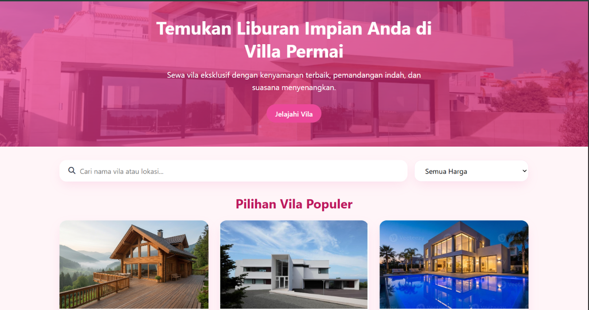

# Tugas Teknologi Web - Villa Permai

## Informasi Mahasiswa
* **Nama:** [muhammad rizki]
* **NIM:** [24011130340]
* **Nama Repository:** `tugas_teknologi_web`

## Deskripsi Singkat Fitur
Proyek ini merupakan halaman web antarmuka (*front-end*) penyewaan akomodasi bernama **Villa Permai**. Halaman web ini menyediakan tampilan yang modern dan responsif bagi pengguna untuk mencari, memfilter harga, dan menjelajahi katalog pilihan vila populer.

## Cara Menjalankan Halaman Web
1. Unduh (*download*) atau *clone* repositori ini ke komputer Anda.
2. Buka folder proyek **`tugas_teknologi_web`**.
3. Cari file **`index.html`**.
4. Klik dua kali pada file `index.html` atau buka menggunakan peramban web (*browser*) seperti Google Chrome, Mozilla Firefox, atau Microsoft Edge.

## Daftar Fitur

### Fitur yang Sudah Selesai
* [x] **Hero Banner Section:** Tampilan header utama dengan latar gambar vila, judul promosi, deskripsi, dan tombol navigasi ("Jelajahi Vila").
* [x] **Fitur Pencarian:** Bilah input pencarian (*search bar*) berdasarkan nama vila atau lokasi.
* [x] **Filter Harga:** Dropdown opsi pemfilteran vila berdasarkan kategori harga.
* [x] **Galeri Vila Populer:** Grid kartu (*cards*) vila populer lengkap dengan gambar pratinjau.
* [x] **Desain Tata Letak (Layout):** Antarmuka visual yang modern dengan skema warna yang konsisten.

### Fitur yang Belum Selesai
* [ ] **Fungsionalitas Pencarian & Filter (JavaScript):** Interaktivitas pencarian dan penyaringan data secara dinamis/real-time.
* [ ] **Halaman Detail Vila:** Halaman spesifik saat salah satu vila populer diklik.
* [ ] **Sistem Reservasi / Pemesanan:** Form pemesanan dan integrasi backend untuk transaksi.

## Tangkapan Layar (Screenshot)
